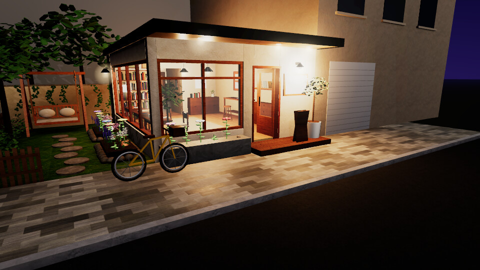
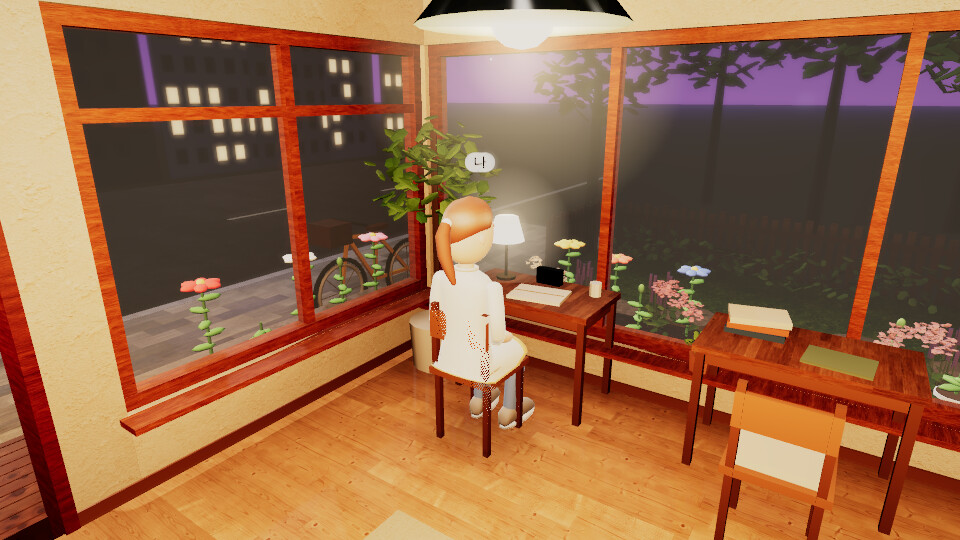
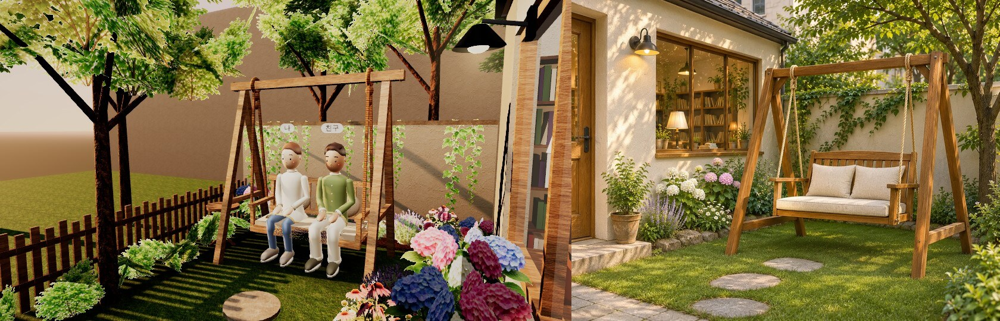
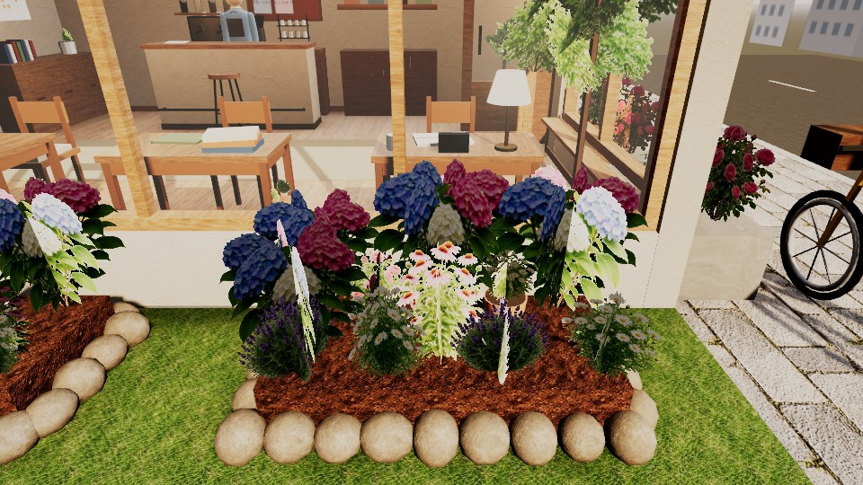
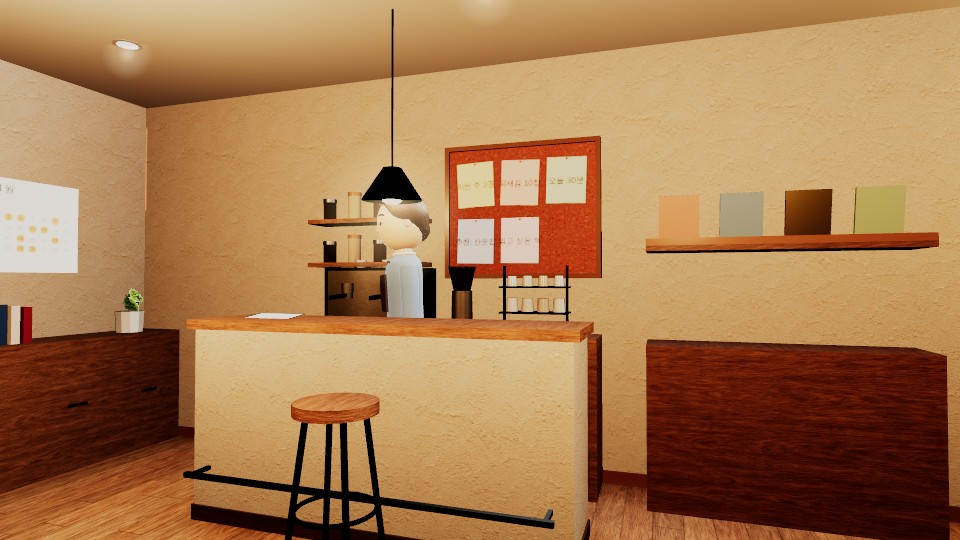
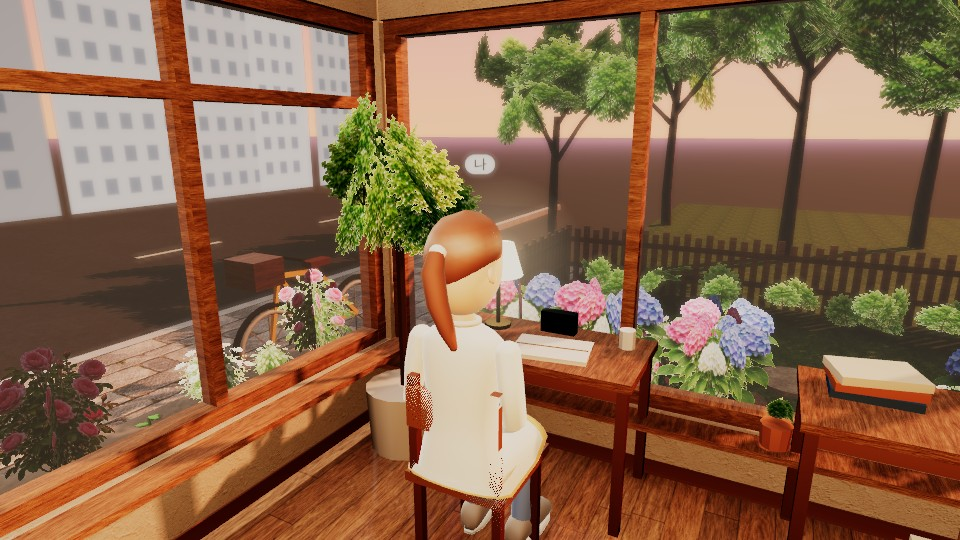
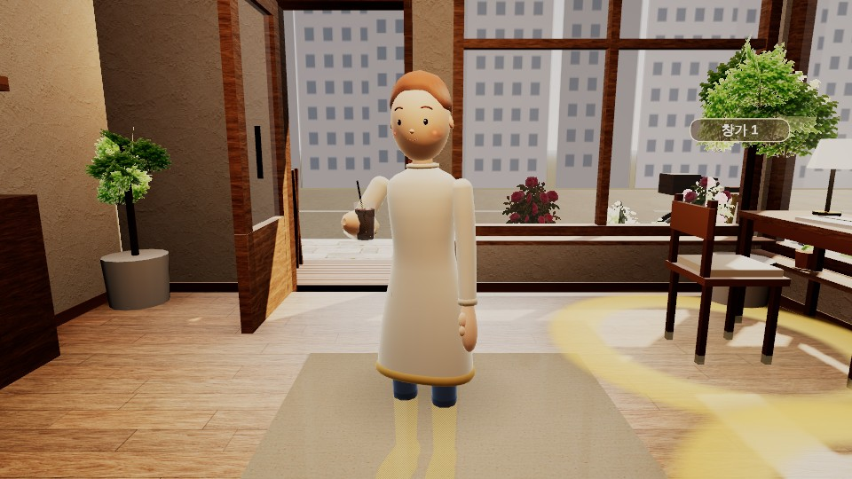

# 3D 공방 패키지 — 독서공방(reading-journal)용 공유판

작성: Claude Opus 5.5 · 2026-11-26 UTC · 원본: rosary-app 의 3D 엔진(같은 소유자, 공유 승인 범위 A·C·D·G)

순수 three.js(r149) 단일 HTML 앱에 넣을 수 있는 3D 장면 엔진 축소판과, 독서공방 「공방 가게」 예시 장면(`ch_house.js`)이다.
WebView·브라우저 어디서나 돌고 Flutter 등 특정 틀이 필요 없다. 오프라인 동작(사진 질감·구운 AO 도 파일로 함께 있다).

- 코드 크기: 약 1.33 MB(`web/*.js` + `test.html`, 질감 제외; 그중 three.min.js 608 KB, 구운 AO·빛 번짐 데이터 약 80 KB) — 목표 1.5 MB 이하
- 질감: `web/tex/` — 소유자 제공 PBR 15벌(색 + 법선 + ORM, 이음매 없앰) + 식물 오림 카드 7장 + CC0 4벌(아스팔트·콘크리트·코르크·황마). 합계는 5절 표
- 사진: `docs/shots/` 10장(960×540, deviceScaleFactor 1) + 그네 마당 참고 그림과 나란히 1장
- 사실감(2차, 2026-11-26): 소유자가 ChatGPT 로 만든 PBR 질감(T01~T60)을 이음매 없이 고쳐 모든 표면에(색·법선·거칠기·AO), 장난감 같던 잎·꽃을 사진 오림
  식물 카드(P01~P07)로, 나무는 껍질 PBR 줄기·가지 + 잎 카드로, 해 길을 돌려 오후 햇빛이 비스듬히(그림자가 보이게), 해:하늘빛 비율을 사진 쪽으로.
- 커피 카운터(2차): 오른쪽 벽 작업대 → 커피 카운터 + 바리스타 + 주문(받으러 가기) + 컵 4종(3절·2절).












## 1. 파일

| 파일 | 하는 일 | 라이선스 |
|---|---|---|
| `web/three.min.js` | three.js r149 | MIT (Copyright 2010-2023 Three.js Authors, 파일 머리에 고지) |
| `web/three_extras.js` | three r149 examples 중 EffectComposer·RenderPass·ShaderPass·UnrealBloomPass·CopyShader·RoomEnvironment·Reflector 만 묶음(`tools/build_extras.mjs`로 다시 만든다; Sky·SSAO·SMAA·RGBE 제외 → 110 KB→22 KB) | MIT (three.js) |
| `web/geo.js` | 정점색 합친 배치(Batch: 수천 도형 = draw call 1), 기본 도형, 캔버스 질감 | 자작 |
| `web/kit.js` | 빌더 도구 `ctx.*`(벽·창(실제 구멍 + 투명 유리 + 창살·창턱)·바닥·천장·상자·원기둥·계단·바닥 구역·충돌체·점광원(최대 3)·빛 무리·누르기 자리·PBR 표면 `surf`) | 자작 |
| `web/kit_tex.js` | 절차 생성 질감(나무·회반죽·돌·체크 등 — 사진이 없을 때의 대체) | 자작 |
| `web/photos.js` | 사진 질감 읽기(`tex/<이름>.jpg` + `_n` + `_orm`(또는 CC0 `_r`), 식물 `plant_<종류>.webp`), 색 sRGB·나머지 선형, 비등방 8, 올리기 전 크기 줄이기, 칸 바꿔 끼우기(`RoomPhotoMap`) | 자작 |
| `web/plants.js` | 사진 오림 식물을 교차 알파 카드로(포기 = 판 2~3장, alphaTest + alpha-to-coverage, 둥근 법선, 종류마다 메시 1) · 잎 카드 · 벽에 붙인 판(담쟁이) | 자작 |
| `web/coffee.js` | 커피: 컵 4종(3D) · 주문 흐름 순수 로직 · 바리스타 NPC(앞치마) · 내 컵/다른 사람 컵 | 자작 |
| `web/world.js` | 월드 코어: 빌더 실행, 시간대 조명(반구광 + 해/달 그림자 + 빌더 점광원), 하늘·구름·별, 창 햇빛 무늬, 바닥 반사, 구운 AO 연결 | 자작 |
| `web/render.js` | 렌더러(sRGB·ACES·물리 조명), PMREM(RoomEnvironment), 블룸·색보정·피사계 심도, 화질 3단계·자동 하향 | 자작 |
| `web/looks.js` | 장면별 룩(노출·색온도·블룸 — 낮/밤) | 자작 |
| `web/ao_fx.js` · `web/gi_fx.js` | 미리 구운 AO(`ao_<id>.js`)·빛 번짐(`gi_<id>.js`)을 재질에 붙임 | 자작 |
| `web/ao_house.js` · `web/gi_house.js` | 공방의 구운 AO(정점 + 바닥 격자) · 빛 번짐(간접광 한 번 튕김 + 색 번짐, 낮·밤). `node tools/ao_bake.mjs house` · `node tools/gi_bake.mjs house` 로 생성 | 자작(생성물) |
| `web/frame_pace.js` | 고주사율 화면 프레임 박자 | 자작 |
| `web/perf_hud.js` | 성능 표시(fps·1% low·draw·삼각형·GPU ms) + 10초 기록 + **30초 벤치** | 자작 |
| `web/controls.js` | 터치/마우스/키보드: 이동 손잡이, 시점 끌기, 두 손가락 확대, 누르기 | 자작 |
| `web/cam_guard.js` | 카메라 쪽 가림물(벽)을 셰이더로 지우는 인형집 단면, 앉은 시점 쪽 고르기 | 자작 |
| `web/scene_logic.js` | 순수 로직(THREE 없음): 좌석(낱자리 `seats`·줄 의자)·충돌 미끄러짐·바닥 높이·조이스틱 | 자작 |
| `web/layouts.js` | 레이아웃 등록부(`RoomLayouts`) | 자작 |
| `web/avatar.js` | 스킨드 아바타(LOD 3단계, 걷기·앉기·서기·인사, 이름표 `cfg.label`) | 자작 |
| `web/palette.js` | 아바타 색표(피부 4·머리 4×2·머리색 10·옷 12) | 자작 |
| `web/markers.js` | 좌석 표식(바닥 빛 고리 + 이름표, 누르기 판정) | 자작 |
| `web/label_fit.js` | 이름표 화면 크기 맞추기 | 자작 |
| `web/audio.js` | 합성 발소리(파일 없음) | 자작 |
| `web/scan3d.js` | 3D 스캔 묶음 로더(로더만, 묶음 없음) | 자작 |
| `web/net_view.js` | 다른 사람 보기(서버 무관 스냅숏 → 보간) + 내 자세 내보내기 | 자작 |
| `web/bridge.js` | 호스트 연결(`window.Room3D`) | 자작 |
| `web/main.js` | 앱 코어: 상태 기계·카메라·그리기 고리·심장 박동·성능 보고 | 자작 |
| `web/ch_house.js` | **예시 빌더: 독서 공방 가게** | 자작 |
| `web/test.html` | 시험 페이지(호스트 흉내) | 자작 |
| `web/tex/{asphalt,concrete,cork,jute}{,_n,_r}.jpg` | CC0 사진 질감 1k(색·법선·거칠기) | **CC0 1.0** — ambientCG(아래 표) |
| `web/tex/<칸>{,_n,_orm}.jpg`(15벌) · `web/tex/plant_*.webp`(7장) | 소유자 제공 PBR 질감 1k(색·법선 OpenGL·ORM) · 식물 오림 카드(알파) | **owner-supplied, generated with ChatGPT** — 소유자 소유 그림, 이 공유 패키지 안에서 쓰도록 제공됨 |
| `tools/tex_build.py` | 소유자 원본(T·P 번호 파일) → `web/tex`: 이음매 없애기·ORM 묶기·색조·바닥 판재·식물 카드 + `docs/seams.json` | 자작 |
| `tools/perf.mjs` | 시점별 draw·삼각형·질감 MB(헤드리스) | 자작 |
| `tools/serve.mjs` · `shot.mjs` · `shots.mjs` | 정적 서버, 한 장/열 장 찍기(Playwright) | 자작 |
| `tools/ao_bake.mjs` · `gi_bake.mjs` · `ao_bvh.mjs` · `harness.mjs` | AO·빛 번짐 굽기(광선 추적, 결정적 — 원본 엔진과 같은 굽기 파이프라인) · BVH · Node 에서 빌더 돌리기 | 자작 |
| `tools/build_extras.mjs` · `extras_entry.js` | three_extras 다시 만들기(esbuild + three@0.149.0 필요) | 자작 |
| `test/*.test.mjs` | Node 단위 시험 + 브라우저 끝까지 시험 | 자작 |

CC0 질감 출처(ambientCG, 모두 CC0 1.0 — 독서공방 저장소 `docs/handover/2026-11-26-metaverse-shop/tex/LICENSES.md` 에 기록된 것을 1k 로 줄임). 2차에서 소유자 질감으로 바뀐 CC0 8벌(WoodFloor040·051, Wood098, Plaster001·002, PavingStones128, Grass004, Ground048)은 지웠다.

| 칸(`surf`) | ambientCG | 쓰는 곳 |
|---|---|---|
| `asphalt` | Asphalt033 | 골목 |
| `concrete` | Concrete034 | 앞 화단 틀, 경계석 |
| `cork` | Cork001 | 코르크 보드 |
| `jute` | Carpet016 | 가운데 러그 |

**소유자 제공 PBR 질감 — owner-supplied, generated with ChatGPT.** 원본 번호(T) → 파일. 색(T01~T18)·법선(OpenGL, 녹색 위)·거칠기·AO 는 소유자가 짝을 맞춰 준 것이고
(T43~T60 의 법선은 DirectX 였던 것을 소유자가 녹색을 뒤집어 OpenGL 로 고침), `tools/tex_build.py` 가 이음매를 없애고(아래) 거칠기·AO 를 ORM 한 장(R=AO, G=거칠기)으로 묶었다.
T10·T11·T14·T15·T16 은 질감이 아니라 장면 그림이라 쓰지 않는다.

| 칸(파일 이름) | 색 | 법선 | 거칠기 | AO | 쓰는 곳(`surf` 이름 — kit.js SURFACES) |
|---|---|---|---|---|---|
| `wood_oak` | T01 | T19 | T27 | T35 | 그네·A 자 틀·창틀·문·가구 전부(`wood_oak`·`wood_light`·`wood_dark` 는 색조만 다름), 카운터 상판, 바 스툴, 그네 옆 탁자 |
| `floor_oak` | T01 에서 깐 판재(판 폭 0.15 m, 1.2 m 타일, 홈·판마다 색 차이) | T19 같은 배치 | T27 | T35 | 실내·복도 바닥(`wood_floor`) |
| `rope` | T02 | T20 | T28 | T36 | 그네 밧줄·매듭 |
| `linen_a` · `linen_b` | T03 · 대화로 받은 리넨 B | T21 · T58 | T29 · T59 | T37 · T60 | 그네 앉는 방석 · 등 쿠션(천 광택 sheen) |
| `metal` | T04 | T52 | T53 | T54 | 벽등·펜던트 갓, 에스프레소 기계·그라인더 몸통 |
| `wood_end` | T05(나이테 한 장 — 이음매 고치지 않음) | T55 | T56 | T57 | 그네 윗보 끝 단면 |
| `lawn` | T06 | T26 | T34 | T42 | 옆마당 잔디, 울타리 너머 풀밭(`grass` 도 같은 그림) |
| `stone` | T07 | T23 | T31 | T39 | 둥근 디딤돌, 화단 돌 테두리, 담 위 돌림띠 |
| `plaster_cream` | T08 | T22 | T30 | T38 | 집 벽(안·밖), 마당 뒤 담, 카운터 앞판, 뒤 건물(`plaster`) |
| `bark` | T09 | T25 | T33 | T41 | 나무 줄기·가지 |
| `soil` | T12 | T46 | T47 | T48 | 화단·화분 흙 |
| `terracotta` | T13 | T43 | T44 | T45 | 테라코타 화분 |
| `brick` | T17 | T24 | T32 | T40 | 오른쪽 이웃 건물(`stucco` 도 같은 그림) |
| `paving` | T18 | T49 | T50 | T51 | 보도 |

**식물 오림 카드 — owner-supplied, generated with ChatGPT**(흰 배경을 지우고 꽃잎을 살린 투명 PNG → 512 px(나무 1024) webp, 알파 가장자리 색 번짐 처리):

| 번호 | 파일 | 쓰는 곳 |
|---|---|---|
| P01 | `plant_rose.webp` | 문 옆·화단 옆 테라코타 화분 장미, 앱 정원 꽃(분홍·빨강) |
| P02 | `plant_echinacea.webp` | 담 앞 꽃줄, 앱 정원 꽃(주황·보라 계열) |
| P03 | `plant_daisy.webp` | 화단 앞줄·담 앞, 앱 정원 꽃(노랑·흰) |
| P04 | `plant_lavender.webp` | 화단 앞줄·담 앞, 앱 정원 꽃(보라) |
| P05 | `plant_hydrangea.webp` | 집 벽 쪽 화단 뒤줄·담 앞, 앱 정원 꽃(파랑) |
| P06 | `plant_tree.webp` | 모든 나무·덤불·화분 나무의 잎 카드(그림의 잎 부분 `TREE_CANOPY_UV`) |
| P07 | `plant_ivy.webp` | 마당 뒤 담의 담쟁이 줄기 11 |

**이음매 없애기(`tools/tex_build.py`, `docs/seams.json`).** 축마다(가로 → 세로) 반 칸 민 사본과 원본의 차이가 가장 작은 길(첫 줄과 끝 줄이 같은 열에서 만나게)을
동적 계획으로 찾아 가장자리 띠는 민 사본, 가운데는 원본을 쓰고 길을 따라 6 px 만 섞는다 — 같은 재질의 네 장(색·법선·거칠기·AO)에 **같은 길·같은 섞기**를 써서 어긋나지 않는다
(법선은 벡터로 섞고 다시 정규화). 이미 이음매가 없던 것(오크·금속, 모든 지도 1.3 미만)은 손대지 않았다. 지표 = 가장자리(마지막↔첫 열·행) 밝기 차 평균 ÷ 안쪽 이웃 차 평균(1.0 이면 구별 안 됨):

| 칸 | 색 전 → 후 | 법선 | 거칠기 | AO |
|---|---|---|---|---|
| rope | 2.43 → 1.03 | 0.98 → 0.96 | 1.31 → 0.98 | 2.58 → 1.26 |
| brick | 1.96 → 0.79 | 2.05 → 0.89 | 2.08 → 0.84 | 3.77 → 0.94 |
| soil | 1.92 → 1.13 | 0.89 → 1.14 | 1.14 → 1.11 | 1.96 → 1.07 |
| bark | 1.85 → 1.08 | 0.87 → 0.94 | 7.83 → 1.06 | 2.61 → 1.19 |
| lawn | 1.56 → 0.94 | 0.94 → 1.01 | 4.07 → 0.98 | 2.45 → 1.05 |
| linen_a · linen_b | 1.56 → 0.86 · 1.56 → 0.93 | ≈1 | 1.18 → 0.88 · 1.17 → 0.95 | 1.62 → 0.97 · 1.56 → 0.93 |
| terracotta | 1.55 → 0.94 | 0.91 → 1.06 | 0.99 → 0.97 | 1.50 → 0.94 |
| paving | 1.40 → 1.20 | 0.82 → 0.96 | 0.94 → 1.13 | 1.40 → 1.07 |
| stone | 1.34 → 1.00 | 0.94 → 0.98 | 1.16 → 1.10 | 2.17 → 0.98 |
| plaster_cream | 1.31 → 1.02 | 1.00 → 1.01 | 1.44 → 1.00 | 2.08 → 1.04 |
| wood_oak · metal | 1.24 · 1.18(고치지 않음) | | | |

(소유자가 잰 1.6~3.3배는 다른 셈법 — 같은 경향이다.) 색조: ChatGPT 색 지도는 채도·밝기가 높아(오크 평균 167,97,34 — 주황) 조명을 받으면 플라스틱처럼 보여
오크·잔디·회벽·테라코타·벽돌·흙의 채도와 평균을 실제 반사율 쪽으로 낮췄다(`TONE` 표). 다시 만들기: `python3 -I tools/tex_build.py <base_zip> <pbr_zip> <pbr_zip2> <plants_cut>`.

**PBR 연결(kit.js `physMat`).** 소유자 칸은 `map`(sRGB) + `normalMap`(선형) + ORM 한 장을 `roughnessMap`(.g)과 `aoMap`(.r) 둘 다로. three r149 의 aoMap 은 둘째 UV(uv2)를 읽는데
배치 지오메트리에는 uv2 가 없어 셰이더에서 `#define vUv2 vUv` 로 첫 UV 를 쓰게 했다(같은 반복). 질감 AO(`aoK` 세기)는 구운 AO(ao_fx — 접촉 그늘)와 곱해진다(간접광에만).
UV 는 월드 박스 투영(미터) — `tile` = 질감 한 장이 덮는 미터(벽 1.6, 바닥 1.2, 벽돌 1.3, 잔디 1.1, 흙 0.7, 밧줄 0.22 …). 비등방 8(기기 최대치로 잘림). 리넨은 천 광택(sheen 0.6).

### 1-1. 질감 칸 바꿔 끼우기(독서공방 저장소의 ChatGPT 질감 — 이 패키지에 없음)
독서공방 저장소 `docs/handover/2026-11-26-metaverse-shop/gpt/`(브랜치 `claude/dokseogongbang-24-7g5n82`)의 ChatGPT 그림은 **색 지도만** 있고,
DESIGN.md·GPT-PROMPTS.md·GPT-TEXTURES.md 에 라이선스 문구가 없다(소유자가 만든 생성물). 그래서 **복사하지 않고** 칸 이름으로만 연결한다.
페이지에서 `photos.js` 를 읽기 전에 `window.RoomPhotoMap = { 칸: 'URL' }` 를 두면 그 칸의 색 지도가 바뀌고 법선·ORM 은 쓰지 않는다(칸 이름은 질감 파일 이름).
못 읽으면 기본 사진으로, 그것도 없으면 절차 생성 질감으로 돌아간다(오프라인 안전). `test.html?gpt=<gpt 폴더 경로>/` 가 아래 표대로 끼운다.

| 칸 | 기대하는 파일 |
|---|---|
| `floor_oak`(바닥) | `gpt/tex/T01-floor-oak.png` |
| `plaster_cream`(벽) | `gpt/tex/T03-plaster.png` |
| `cork` | `gpt/tex/T04-cork.png` |
| `jute` | `gpt/tex/T05-rug.png` |
| `paving` | `gpt/tex/T06-paving.png` |
| `asphalt` | `gpt/tex/T07-asphalt.png` |
| `soil` | `gpt/tex/T08-soil.png` |
| `lawn` | `gpt/tex/T09-grass.png` |
| (없음) | `T10-stepping-stone.png` 은 이음매 없는 질감이 아니라 오려 쓰는 한 장이라 칸이 없다(디딤돌은 3D 원기둥 + `concrete`) |
| 배경 판 | `setPanel({id:'backdrop', data:{day:'gpt/P-01-alley-day.png', night:'gpt/P-01-alley-night.png'}})` — 시간대에 맞춰 바뀐다 |
| (없음) | `P-06-wall-art.png` — 액자 그림 자리(지금은 색 면)는 B 항목 |

## 2. 브리지 API (`web/bridge.js`)

### 들어오는 호출(호스트 → 장면)
세 길 중 아무 것이나. 장면이 준비되기 전 호출은 줄에 쌓였다가 처리된다(손잡이·누르기 제외).
```js
window.Room3D.setHour({ hour: 21 });                                          // ① 같은 페이지 / WebView evaluateJavascript
frame.contentWindow.postMessage({ room3d: 'call', fn: 'setHour', args: { hour: 21 } }, '*');   // ② iframe
window.Room3D.call('{"fn":"setHour","args":{"hour":21}}');                    // ③ 문자열 JSON 한 줄
```
| 메서드 | 인자 | 뜻 |
|---|---|---|
| `init` | `{room:'house', avatar, hour, quality:'auto'|'high'|'mid'|'low', fixedClock, poseHz}` | 장면 시작(호스트가 부르는 페이지는 `window.RoomNoAutoStart = true`) |
| `setSeats` | `[{i, taken, mine}]` | 좌석 점유(예: RTDB 독서실 자리). 남이 가진 자리는 표식이 숨고, 내 자리를 남이 가져가면 일어선다 |
| `setMe` | `{avatar:{g, skin, style, hair, outfit, label}}` | 내 아바타 |
| `setHour` | `{hour}` | 시간대(낮 기본·밤 조명 프리셋은 looks.js `house`) |
| `setTimerText` | `{text:'25:00'}` | 창가 1 책상의 타이머 화면 |
| `setPanel` | `{id, data}` | 판 다시 그리기: `sign{title,sub}` · `timer{text}` · `board{notes:[…]}` · `tablet{title,lines}` · `calendar{month,marks}` · `backdrop{url | day,night}` |
| `setGarden` | `[{flower:0..7, stage:0..3, pot:0|1|2}]` | 화단 16자리(앞 화단 6 + 옆마당 화단 5+5). stage 0 씨앗·1 새싹·2 봉오리·3 꽃 |
| `setSkin` | `{skin:'oak'|'walnut'|'white'}` | 바닥 나무 색조(자리 표시용) |
| `orderCoffee` | `{kind:'americano'|'latte'|'iced'|'tea'}` | 커피 주문(무료·가상). 바리스타가 약 3초 만들고 카운터에 컵 → 다가가면 집는다(3절) |
| `setMyCup` | `{kind}` 또는 `{kind:null}` | 들고 있는 컵 되돌리기(다시 열었을 때 호스트가 기억한 컵 — 앉아 있으면 그 좌석 컵 자리에) |
| `pause` / `resume` / `dispose` | — | 그리기·소리 멈춤/재개 / WebGL 문맥까지 정리 |
| `setPeers` | `[{id, x, z, yaw, state:'walk'|'sit', seat, avatar, cup}]`, `{partial}` | 다른 사람(4절). `cup` = 든 음료 종류(걷는 사람은 손에, 컵 자리가 있는 좌석에 앉은 사람은 그 자리에) |
| `sit` / `stand` | `{i}` / — | 앉기(번호 없으면 가까운 빈자리) / 일어서기 |
| `setJoystick` | `{x, y}` | 호스트가 그린 이동 손잡이(-1..1) |
| `setQuality` · `setPerfHud` · `setSteps` · `setPoseRate` · `setViewInset` · `setCamera` · `tapAt` | | 화질 · 성능 표시 · 발소리 `{on, vol}` · 내 자세 보내기 빈도 `{hz}` · 아래 패널 비율 `{bottom}` · 카메라 `{dist, follow, view:'tp'|'fp'}` · 화면 좌표 누르기 `{x, y}` |

### 나가는 이벤트(장면 → 호스트) — `{e:'이름', …}`
있는 길로 모두 보낸다: ① `window.Room3DHost.postMessage(JSON 문자열)`(네이티브 셸이 심은 객체) ② iframe 이면 `parent.postMessage({room3d:'event', …})`
③ 같은 페이지면 `Room3D.on(fn)` 과 `window` 의 `room3d` CustomEvent.

| 이벤트 | 내용 |
|---|---|
| `ready` | 스크립트 준비(init 을 부를 수 있다) |
| `firstFrame` | 첫 그림(입장 화면을 걷을 때) |
| `seatTap {i}` | 좌석(표식·의자)을 누름 — 자리 잡기는 호스트가 정하고 `sit({i})` 로 앉힌다 |
| `sat {i}` / `stood {i}` | 앉기·일어서기 완료 |
| `perf {fps, tier}` | 4초 뒤 첫 표본, 이후 5초마다(구간 평균) |
| `tierDown {tier, fps}` | 자동 화질 하향(평균 프레임 45 ms 초과) |
| `glFail {msg}` | WebGL 을 만들지 못함(호스트가 2D 대체 화면으로) |
| `contextLost` / `contextRestored` | WebGL 문맥 잃음/되찾음 |
| `myPose {x, z, yaw, state, seat, t}` | 내 자세(onMyPose, 4절) |
| `nearCounter {on}` | 카운터 앞(주문 안내 구역 `layout.coffee.near`)에 서면 `true`, 벗어나거나 앉으면 `false` — 호스트가 메뉴(주문 안내)를 띄우고 닫는다 |
| `coffeeOrdered {kind}` · `coffeeReady {kind}` · `coffeePicked {kind}` | 주문 받음 · 다 만들어 카운터에 놓음 · 내가 집어 듦(호스트는 `cup` 을 내 자세와 함께 다른 사람에게 보내면 된다) |
| `tap {id}` | 빌더 누르기 자리(`innerDoor` = 복도 끝 나무 문 → 앱 서재 화면으로) |
| `error {kind, msg}` · `hb {f, st}` · `perfReport {text}` | 오류 · 1초 심장 박동 · 성능 기록 |

## 3. 예시 장면 `ch_house.js`(DESIGN.md 안 A)
- 실내 5.0×6.6 m · 천장 2.7 m(바닥은 데크 한 단 위 0.16 m) + 안쪽 복도 1.2×2.4 m 끝 나무 문(잠긴 장식 문, 누르면 `tap{id:'innerDoor'}`).
- 왼쪽 벽 통창(바닥 0.35 m~2.35 m, 창살 3) + 정면 창(창살·가로살), 두 창은 앞 왼쪽 모서리에서 만난다(모서리 기둥만 남음). 벽은 두께 0.2 m, 창은 실제 구멍 + 나무 틀·창턱.
- 유리 낀 나무 문(안으로 열려 있음) + 데크 한 단, 간판(독서공방 SINCE 2026)·벽등·화분 나무·세로 입간판·노란 자전거·가로등.
- 좌석 **6**: `0~2` 창가 1인 책상(창을 봄) · `3` **커피 카운터 바 스툴**(좌판 0.75 m, 발판 0.3 m, 카운터를 봄) · **`4·5` 옆마당 2인 그네**(옆에 작은 오크 탁자).
  그네는 소유자 참고 그림(`ref_swing_yard`)을 따른다: A 자 오크 틀, 살 등받이·팔걸이, 윗보에 감아 맨 황마 밧줄 둘, 크림 리넨 방석 + 등 쿠션 둘, 둥근 디딤돌이 깔린 잔디,
  집 벽을 따라 돌 테두리 화단(수국·라벤더·앱 꽃), 검은 헛간 벽등, 큰 나무 창틀 창, 담쟁이 낀 회벽 담. 참고 그림과는 좌우가 거울(집이 그네의 오른쪽) — 마당이 집 왼쪽에 있기 때문.
  누가 앉아 있을 때만 앞뒤로 ±1.6°(3.6초 주기) 아주 작게 흔들리고, 앉은 아바타도 같은 만큼 옮겨져(`hooks.seatOffset`) 어긋나지 않는다. 움직임 줄이기 설정이면 흔들지 않는다.
- 조명: 펜던트 2(점광원, 약 3000K) + 벽등(점광원) + 다운라이트 6 + 복도 등 + 플로어 스탠드 + 책상 등(발광 + 빛 무리). 낮/밤은 시간대 + 룩(`looks.js` house).
- 옆마당: 잔디 · 둥근 디딤돌 7 · 낮은 울타리 + 뒤 회벽 담(담쟁이 줄기 11, 담 앞 좁은 꽃줄) · 화단 2 · 나무·덤불, 앞 화단 1(정면 창 아래), 울타리 너머 풀밭.
  식물은 사진 오림 카드(`plants.js`): 참고 그림처럼 집 벽 쪽 화단 뒤줄에 수국, 앞줄에 라벤더·데이지, 문 옆 테라코타 화분에 장미, 담 앞에 수국·라벤더·에키네시아·데이지.
  나무(옆마당 1 · 담 너머 3 · 골목 쪽 5 · 화분 나무)는 껍질 PBR 원기둥 줄기 4마디 + 가지 4~5 + 가지 끝마다 잎 카드 덩어리. 앱 정원 꽃(`setGarden`)도 봉오리·꽃은 카드(색 8 → 사진 꽃 + 색조), 씨앗·새싹은 작은 3D 도형.
- **커피 카운터**(오른쪽 벽, 작업대 자리 — 글자·상표 없음): 앞 카운터(오크 통판 상판 1.05 m + 회벽 앞판 + 검은 발 받침 봉), 바리스타 통로(0.4 m, 통로 전체가 충돌체),
  뒤 카운터(서랍 3) 위 에스프레소 기계(솔질 금속 몸통 + 검은 판, 그룹 헤드 2·포터필터·스팀 막대·받침·데운 잔 4), 그라인더, 컵 선반(머그·잔 8), 그 위 열린 선반 2(병 8), 카운터 위 금속 펜던트.
  코르크 보드는 오른쪽으로 좁혀(0.94 m) 남겼고 태블릿 판은 카운터 끝에. 점광원 한도(3) 때문에 카운터 펜던트는 발광 + 빛 무리이고 카운터 위 빛은 구운 빛 번짐이 맡는다.
- **커피 주문(받으러 가기, `coffee.js`)**: 카운터 앞에 서면 `nearCounter{on:true}` → 호스트가 메뉴 4(아메리카노·라떼·아이스 커피·홍차, 모두 무료·가상 — 돈은 어디에도 없다)를 띄운다 →
  `orderCoffee({kind})` → 바리스타가 기계 쪽으로 돌아 약 3초 '음료 만들기' 몸짓 → 카운터 끝 픽업 자리에 컵 + `coffeeReady` → 1.3 m 안으로 다가가면 집어 들고 `coffeePicked` →
  오른손을 가슴 앞으로 들어 쥔다 → 아무 좌석에 앉으면 그 좌석의 컵 자리(창가 책상·카운터·그네 옆 탁자)에 내려놓고, 일어서면 다시 든다(컵 자리가 없는 좌석이면 든 채로).
  새로 주문하면 들던 잔은 사라진다(한 사람 한 잔). 컵 4종은 한눈에 다르다: 회청 유약 머그 / 넓은 잔 + 받침 + 라떼 아트(하트·로제타 그림) / 투명 유리 + 얼음 + 빨대 / 낮은 찻잔 + 받침 + 홍차.
- **바리스타**: 지금 몸(avatar.js) + 앞치마(짙은 회갈색), 중성 색 옷. 카운터 뒤 통로 사각형(`layout.coffee.barista`) 밖으로 나가지 않고, 숨쉬기·시선은 몸이 하며,
  손님이 3 m 안이면 그쪽으로 돌아서고, 만드는 동안은 기계 앞으로 반 걸음. **몸 바꿔 끼우기 약속**: `RoomAvatar.bodyToCfg({gender, face, hair, hairColor, outfit, label})` 가
  지금 몸의 cfg 를 만들고, 컵 고리는 몸과 무관한 이름 — `setHold(on)`·`holdAnchor()`(쥔 물건을 붙일 Object3D)·`playGesture('brew', 초)`·`setSeated`·`setApron(색|null)`.
  다음 몸(반실사 등)은 이 이름들만 같으면 coffee.js·net_view.js 를 고치지 않아도 된다.
- 골목: 보도·경계석·아스팔트 + 먼 배경 판(길 건너 건물 줄, 절차 그림 — `setPanel backdrop` 으로 바꿈) + 이웃 건물 덩어리.
- 썸네일 카메라 4: `?thumb=0` 외관(골목에서) · `?thumb=1` 실내(복도 쪽을 보며) · `?thumb=2` 옆마당 화단 가까이 · `?thumb=3` 커피 카운터와 바리스타.
- 해 길: `layout.sunRot = 100`(도) — 오후 해가 마당 쪽(왼편) 앞에서 비스듬히 들어와 정면 벽에 결이 살고 그림자가 옆으로 눕는다(world.js 가 해 방향을 돌린다).
- 충돌체는 순수 함수 `planColliders()` 하나 — 화면(build)과 시험이 같은 목록을 쓴다. 집 뒤·이웃 건물은 막혀 있고, 집은 문으로만 드나든다.
- 아직 B 항목 도구가 없어 단순 대체: 판(간판·타이머·코르크 쪽지·태블릿·캘린더)은 3D 틀 위의 캔버스 면, 전시 선반 표지·액자 그림은 색 면, 책은 상자.

## 4. 걷는 사람 보이기(G) — `net_view.js`
- 들어오기: `setPeers([{id, x, z, yaw, state, seat, avatar}])` 를 받는 대로(2~4 Hz 권장). 목록에 없는 사람은 1.5초 뒤, 소식이 8초 없으면 지운다(`partial:true` 면 빠진 사람을 지우지 않음).
- 보간: 사람마다 표본 4개, 지금보다 delay(받는 간격 × 1.6, 180~900 ms) 앞의 자리를 그린다. 끝 표본을 앞지르지 않는다(멈춘 사람이 미끄러지지 않게).
  한 번에 2.5 m 넘게 뛰거나 2.5초 넘게 끊겼다 오면 보간 없이 그 자리로 옮긴다. 앉은 사람은 좌석 자리로(0.7초 앉는 동작).
- 내보내기(onMyPose): `myPose` 이벤트를 `hz`(기본 3, `setPoseRate`)로 — 5 cm·0.05 rad 이상 움직였을 때만, 앉기/서기 같은 상태 변화는 바로, 멈춰 있으면 2초마다 한 번(살아 있음).
- **원본(로사리움) 현장감 설계에서 가져온 것**(rosary-app `docs/church/SPEC.md` §3·§6·§12, `server/church/src/room_logic.ts` — 원본 서버는 설계·시험까지이고 실서비스 배포 기록은 없어 실측이 아니라 설계 판단이다):
  내 위치는 클라이언트가 권위이고 **움직이는 동안만 5 Hz 이하**로 보내며 멈추면 '멈춤'(m:0)을 한 번 보낸다 — 받는 메시지가 과금 대상이라 멈춘 사람(대부분 앉아 있다)은 보내지 않는다.
  서버는 바뀐 사람만 **5 Hz 스냅숏 하나로 묶어** 내려보내고, 받는 쪽은 스냅숏 사이를 **200 ms 지연 보간**한다. 앉기·일어서기는 위치와 따로 이벤트로 보내 좌석은 서버가 권위(이미 찼으면 거절)다.
  끊기면 그 사람의 좌석·아바타를 **바로** 지우고, 앱은 1·2·4·8·16초(상한 30초) 지수 백오프로 다시 붙는 동안 혼자 모드로 계속 걷게 한다. 받는 메시지는 초당 12개, 속도는 7 m/s 로 막고, 화면에는 가까운 80명만 그린다(서버는 반경 40 m 관심 영역).
  이 패키지는 이를 RTDB(풀 스냅숏 setPeers)에 맞춰 옮겼다: 2~4 Hz 에서는 200 ms 고정 지연이 표본 간격보다 짧아 끊겨 보이므로 지연을 받는 간격의 1.6배로 늘렸고(이 부분은 원본이 아니라 이번 설계 판단),
  RTDB 는 끊김 알림이 늦을 수 있어 '스냅숏에서 빠진 지 1.5초'·'소식 없음 8초' 두 단계로 지운다. 3 Hz·소수점 2자리(한 번 약 40바이트)면 4명 방에서 초당 0.5 KB 남짓이다.

## 5. 시험·사진
```sh
node --test test/*.test.mjs          # 단위(scene_logic·집 충돌/빠져나가기/갈 수 있는 곳·좌석·그네·net_view·bridge·AO 최신·커피·질감·식물 카드) + 브라우저 끝까지(e2e 2: 브리지·커피 흐름)
node tools/shots.mjs                  # docs/shots/*.jpg 10장(외관 낮·밤, 실내, 앉은 시점, 마당 그네, 걷는 두 사람, 화단 가까이, 커피 카운터, 책상 위 라떼, 손에 든 아이스)
node tools/perf.mjs                   # 시점별 draw·삼각형·질감 MB(6절 표)
python3 -I tools/tex_build.py <base_zip> <pbr_zip> <pbr_zip2> <plants_cut>   # 소유자 원본 → web/tex(이음매·ORM·식물 카드) + docs/seams.json
node tools/shot.mjs "thumb=1&hour=21" /tmp/a.png    # 한 장
node tools/serve.mjs 8123             # 브라우저로 http://127.0.0.1:8123/test.html (사진 질감은 http 로 열어야 올라간다)
node tools/ao_bake.mjs house && node tools/gi_bake.mjs house   # 지오메트리를 바꾼 뒤 다시 굽기(--check 로 최신인지만; test/bake.test.mjs 가 어긋나면 실패)
```
- 필요: Node 22, `playwright`(Chromium), 질감 다시 만들기는 Python 3 + Pillow + numpy. 브라우저 시험·사진은 소프트웨어 렌더(swiftshader)라 느리다(사진 10장 약 15분).
- `test.html` URL: `room hour quality autotier frames thumb sit peerseat view peers route x z yaw pitch zoom look hideui fixed gpt cup coffee camturn`.
  `route=street` 걷는 사람이 가게 앞 보도를 마주 오간다 · `cup=종류` 컵을 든 채 시작 · `coffee=종류` 시작하자마자 주문 · `camturn=도` 카메라를 아바타 둘레로 돌린다.
  카운터 앞에 서면 화면 아래에 메뉴 4(호스트 흉내)가 뜬다.
- 시험 수: 단위 47 + 브라우저 2 = **49**(`test/coffee`·`textures`·`plants` 가 2차에서 늘었다 — 질감 파일·1024²·이음매 ≤1.3·식물 비율·알파 카드 재질·땅에 선 높이·ORM 연결·컵 모양·주문 흐름·좌석별 컵 자리·바리스타 충돌체·다른 사람 컵).

## 6. 성능 예산(중급 안드로이드)과 30초 벤치
- 예산: **보이는 삼각형 약 170k · draw call 약 260 · 질감 80 MB 이하**. 지금 공방(960×540, 헤드리스 측정): 본 그리기 한 번(간단 단계 — 그림자·반사 없음) 삼각형 **71k(외관)·95k(실내)·113k(사람 셋)**, draw **49~56**. 높음 단계는 그림자 맵·바닥 반사 패스까지 더해 프레임 합계 190k~254k 삼각형·draw 104~156. 정적 장면 111k 삼각형(잎 수천 장 포함). 질감 파일은 1k 지만 `photos.js` 가 올리기 전에 줄인다(가까이 크게 보이는 바닥·벽 색 1024, 다른 색·법선 512, 거칠기 256; 같은 그림은 한 번만 올림) → 장면 재질 질감 합계 **약 80 MB**(밉맵 포함 추정, 렌더 타깃 제외 — 헤드리스 측정). 고사양은 `window.RoomPhotoMax = 1024`.
- 화질 자동 하향: 높음 → 보통 → 간단(3초 평균 45 ms 초과). 앉아 가만히 있으면 30 fps 로 쉰다.
- **30초 벤치(기기에서)**: 서 있는 상태에서 `setPerfHud({on:true})`(또는 `?perfhud=1`) → 오른쪽 위 「30초 벤치」. `layout.benchPath`(스폰 → 데크 → 실내 → 복도 끝)를 따라 12초 걷고(카메라 ±60° 흔듦) 6초 제자리 한 바퀴, 12초 되돌아온다.
  끝나면 평균·1% low fps, 50/100 ms 넘는 프레임 수, 해상도·draw·삼각형 최대, 질감 MB, GPU 이름을 보여 주고 `perfReport` 이벤트로 넘긴다(클립보드 복사도 시도). 같은 기기에서 화질 단계별로 한 번씩.

## 7. 원본에서 뺀 것과 이유
- **종교 요소 전부**(공유 조건): 제대·감실·십자고상·성수대·독서대·발다키노·성상·벽감·촛불대/봉헌초·불꽃·스테인드글라스·장미창·사진 창·후진·돔·궁륭·늑골·메달리온 띠·줄 의자의 무릎틀,
  아바타의 기도·무릎 꿇기·성호·묵주·세례명 목록, 출입 금지(경건) 모듈, 전례 장식, 십자가의 길, 성상 스캔 묶음, 성당별 룩·사진 팩·HDRI, 오르간·종소리. 주석의 해당 언급도 정리했고 이름공간을 `Church*` → `Room*` 로 바꿨다.
- 원본 앱 전용: Flutter 채널(→ 범용 브리지), 창 감상실, 반사 탐침·부드러운 빛줄기(파일 미포함), 자동 걷기 「가기」 경로 탐색·스테이션 표식(→ 좌석 표식), 혼자 모드 배경 인물(NPC), 터치 기록.
- 용량: three_extras 에서 Sky·SSAO·SMAA·RGBE 제외.

## 8. 아직 없는 것
- **B** 새 소품 도구(카드·글 판·책장 끼우기·전시 선반 표지·액자 그림 등) — 지금은 단순 대체.
- **E** 조명 정식판(시간대 연출·노을/새벽 전용 룩·라이트맵) — 지금은 낮/밤 기본 프리셋(ACES, 밤 실내 약 3000K) + 구운 AO·빛 번짐. 빛 번짐 굽기는 원본의 HDRI 대신 RoomEnvironment 평균(고른 0.5)을 쓴다.
- **F** 나머지(카메라 경로 재생기·첫 입장 소개·튜토리얼 등), **H**, **I**.
- 실기기 성능은 재지 않았다(위 30초 벤치로 잰다). 앱 정원 그림(일러스트)과 실사풍 가게가 어울리는지는 앱에서 봐야 한다.
- 2차에서 남은 것(솔직히): 아바타는 아직 장난감 몸이다(반실사 몸으로 바꾸는 것은 따로 — 몸 약속은 3절). 식물 카드는 가까이서 판이 보일 수 있다(특히 나무 잎 카드 가장자리).
  하늘은 그라디언트(HDRI 없음)라 사진 같은 하늘·먼 풍경은 아니다. 커피 카운터 위 빛은 점광원 한도로 구운 빛 번짐뿐. 컵을 집는 손가락 모양은 없다(손 뼈에 붙임).
