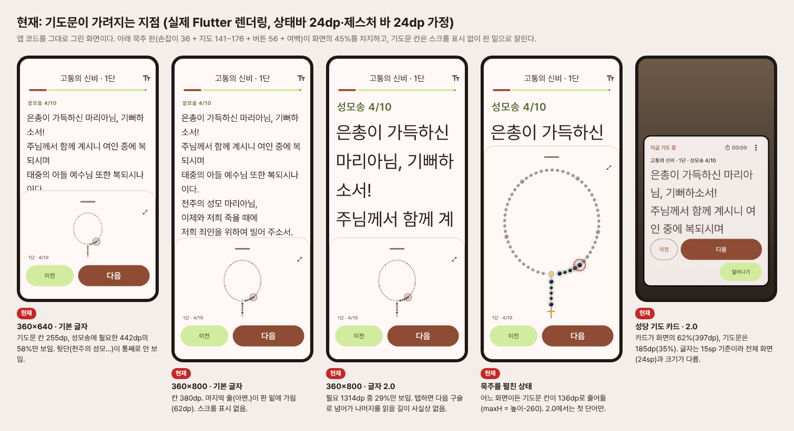
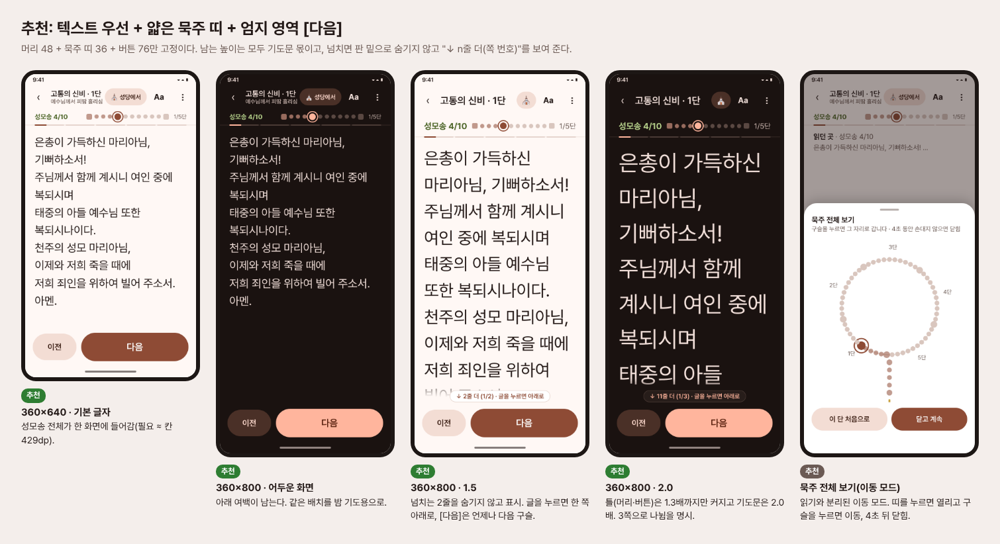
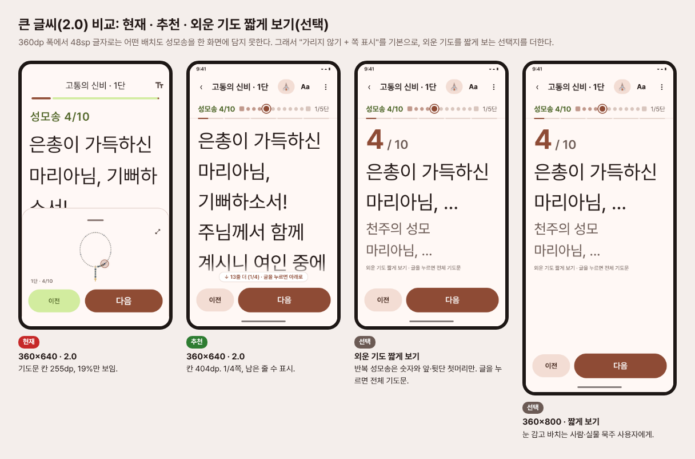
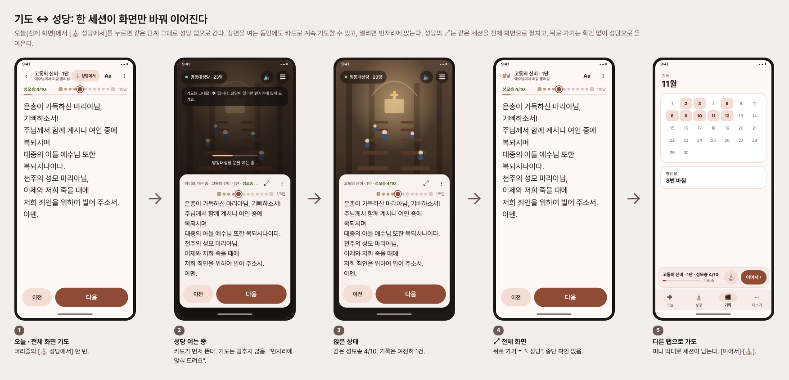
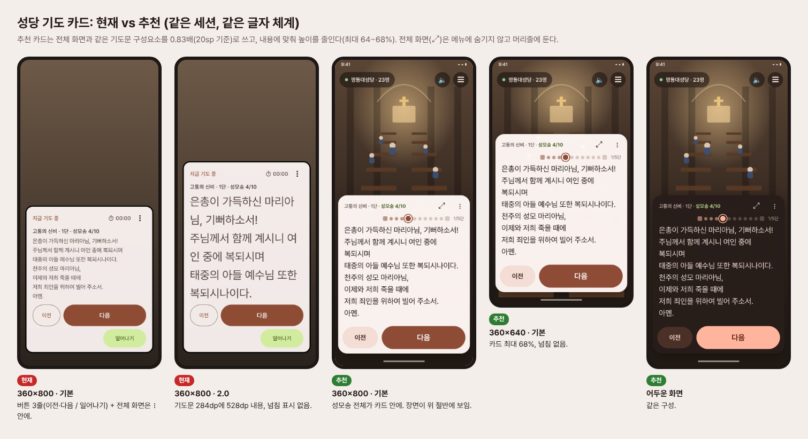
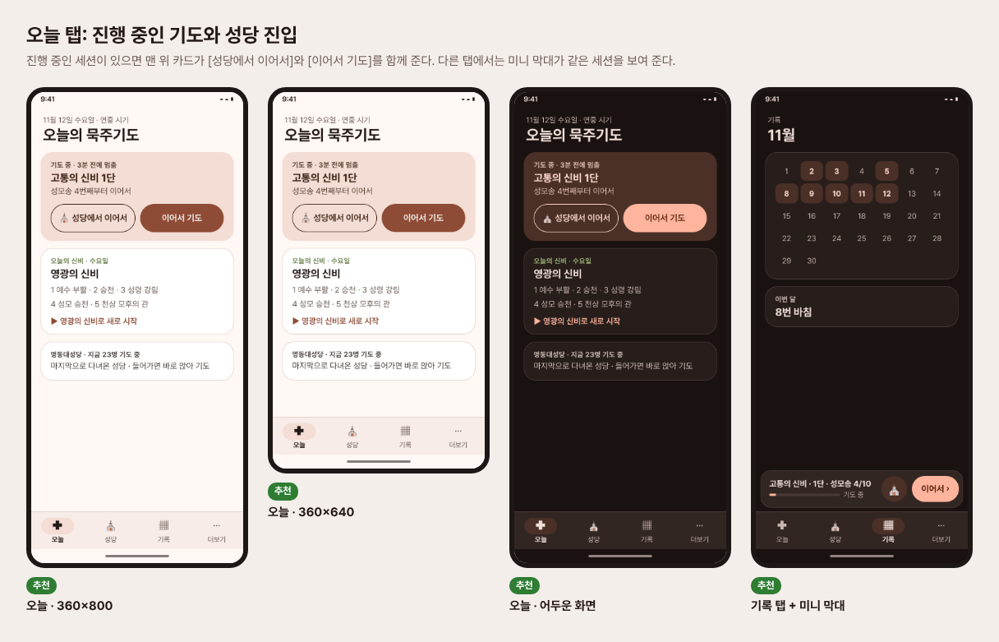

# 기도 화면 · 성당 기도 재설계

작성일: 2026-11-12 · 대상: `lib/ui/prayer_screen.dart`, `lib/church/church_prayer_card.dart`, 기도 세션 구조
요청(사용자 원문): "묵주기도를 하면서 다시 성당으로 돌아가는 것도 자연스러워야 하는데 양쪽이 차단된 느낌. 묵주기도 때도 기도문이 가려지고 … 이게 최선인가"

**근거 표기**: `[측정]` = 이번에 저장소 코드를 그대로 Flutter 테스트 환경에서 그려서 잰 값(Pretendard 실제 글꼴, 상태바 24dp·제스처 바 24dp 가정, 스크래치 복사본에서 실행, 저장소는 건드리지 않음). `[코드]` = 파일:줄. `[S]` = 조사 문서(rosary_apps.md)나 검색 요약에 나온 스토어 문구·리뷰(직접 써 보지 않음). `[I]` = 추론. 경쟁 앱의 화면 배치는 스크린샷을 직접 확인하지 못했다. 표의 배치 설명은 대부분 `[S]` 또는 `[I]`다.
줄 번호는 작성 시점 기준이다. `lib/church`는 다른 작업자가 수정 중이라 줄 번호가 바뀔 수 있어 함수 이름을 함께 적었다.

---

## 1. 결론

**한 줄 결론: 지금 설계는 최선이 아니다. 화면의 45%를 장식에 가까운 묵주 지도에 주고 기도문은 판 밑으로 잘라 버린다. 앱 기도와 성당 기도는 이름만 같고 실제로는 서로 다른 두 세션이다. 그래서 사용자가 느낀 '가려짐'과 '차단'은 둘 다 실제로 있는 결함이다.**

'이게 최선인가'에 대한 정직한 답은 다음과 같다.
- **아니다.** 360×640 폰에서 기본 글자 크기로 성모송 한 번을 끝까지 볼 수 없다(58%만 보임, `[측정]`). 1.5배, 2.0배로 키운 어르신은 성모송의 1/3~1/5만 보고 기도한다. 넘친 부분이 있다는 표시도 없다. 글을 누르면 다음 구슬로 넘어가므로 아래를 읽으려면 손가락으로 끌어야 한다는 것도 알 길이 없다.
- **두 세계 문제는 느낌이 아니라 구조 문제다.** 오늘 탭 기도(`PrayerScreen`)와 성당 기도(`ChurchPrayerController`)가 세션, 기록, 신비 선택, 글자 크기, 진동을 각자 따로 가진다. 그래서 오늘 탭에서 바치던 기도를 성당에서 이어 바치면 기록이 2건 남고, 신비가 요일 신비로 바뀌며, '이어서 기도하기' 저장분도 덮어써진다(2.2절).
- **좋은 바탕은 이미 있다.** 정확한 이어하기, 차등 진동, 볼륨 키, 선창 음성, 세션 하나에 기록 하나라는 규칙, 성당 혼자 모드가 그렇다. 그래서 다시 짓지 않아도 된다. 고칠 것은 **화면의 우선순위**와 **세션의 주인**이다.

**추천**: 텍스트를 최우선으로 두고 묵주는 얇은 띠로 보여 준다. 엄지 영역에 [다음]을 둔다. 세션은 앱 전체에 **하나만** 두고 전체 화면, 성당 카드, 미니 막대는 그 세션을 보여 주는 화면일 뿐이다. 2단계로 나눠 낸다. 1단계(약 3~4일)는 위험이 낮은 텍스트 우선 수정이고, 2단계(약 6~8일)는 통합 세션이다.

---

## 2. 현재 문제 진단

### 2.1 기도 화면의 높이 예산 `[측정]`

세로 화면은 위에서부터 이렇게 쌓인다(`prayer_screen.dart:424-461`, `:774-856`).
상태바 24 → AppBar 56 + 진행 막대 16 (`:440-457`) → **기도문 칸** (`Expanded`, `:804`) → 판(`_ControlBar`, `:859-889`): 위 여백 12 + 손잡이 36 + 묵주 지도(화면 높이의 22%, 120~190, `:607-611`) + 10 + [이전][다음] 56 + 아래 여백 10 → 제스처 바 24.

| 화면 | 위(상태+AppBar) | 기도문 칸 | 아래 판 | 기도문 칸 비율 |
|---|---|---|---|---|
| 360×640 | 96 | **255** | 289 | 40% |
| 360×800 | 96 | **380** | 324 | 48% |
| 412×915 | 96 | **481** | 338 | 53% |
| 640×360 가로(넓은 배치, `:725-772`) | 96 | 264 | (오른쪽 칸) | – |
| 묵주를 펼친 상태(모든 세로 화면) | 96 | **136** | 나머지 | 17~21% |

펼친 상태의 칸이 화면과 상관없이 136dp로 고정되는 이유는 `maxH = min(높이×0.72, 높이−260)`(`:622-625`) 때문이다. 큰 화면일수록 지도만 커진다.

**성모송(고통의 신비 1단 4/10, '혼자' 모드)이 필요한 높이와 실제로 보이는 비율**

| 기도문 배율 | 필요 높이 | 360×640 | 360×800 | 412×915 | 가로 640×360 | 펼침(360×800) |
|---|---|---|---|---|---|---|
| 1.0 | 442 | **58%** | 86% | 100% | 60% | 31% |
| 1.5 | 710 | 36% | 54% | 68% | 37% | 19% |
| 2.0 | 1314 | **19%** | 29% | 41% | 20% | 10% |
| 2.0 + OS 글꼴 1.3 | 2094 | 12% | 18% | 27% | 13% | – |

1단 첫 구슬(신비 안내 카드 + 주님의 기도)은 1.0에서도 360×640 37%, 360×800 55%만 보인다. 후창 모드는 성모송이 조금 짧아(383dp) 360×800 1.0에서 거의 다 보이지만, 1.5부터는 같은 문제가 생긴다.

**언제 가려지나 (요약)**
- 360×640: **기본 글자에서도** 성모송 뒷단(천주의 성모 마리아님…)이 판 밑에 있다.
- 360×800: 1.0에서 마지막 줄 '아멘.'이 가려진다(62dp). 1.3배 이상에서는 뒷단 전체가 가려진다.
- 412×915: 1.0만 안전하다. 1.3 이상에서는 가려진다.
- 묵주를 펼치면 어느 화면이든 3~4줄만 남는다.

**구조적 원인 5가지**
1. **지도가 주인공이다.** 지도+손잡이에 177~226dp를 쓰지만 사용자가 거기서 얻는 정보는 '1단 · 4/10' 한 줄이다(`rosary_map.dart:431-441`). 지도를 끌어 구슬을 넘기는 기능(`prayer_screen.dart:470-476`)은 숨은 기능이다.
2. **잘림을 알리지 않는다.** 기도문은 `SingleChildScrollView`(`:649`)라 스크롤은 되지만, 넘침 표시도 그림자도 없다. 둥근 판 윗변이 글자를 반쯤 자른다(보드 그림 참조).
3. **탭과 스크롤이 충돌한다.** 기도문 아무 데나 누르면 다음으로 넘어간다(`:639-641`). 넘친 줄을 보려는 탭이 구슬 하나를 건너뛰게 만든다.
4. **배율이 두 번 곱해진다.** 기도문 크기는 `24 × prayerTextScale`(`:984`)이고, `Text`가 OS 글꼴 배율을 한 번 더 곱한다. 앱 2.0 × OS 1.3 = 2.6배가 된다(위 표 마지막 줄).
5. **틀도 함께 커진다.** 제목 줄 `step.title`도 배율을 따른다(`:668`). 그래서 큰 글씨에서는 '성모송 4/10' 한 줄이 1~2줄을 차지한다.

### 2.2 '두 세계' 문제 `[코드]`

| # | 현상 | 근거 | 사용자가 겪는 것 |
|---|---|---|---|
| W1 | 세션이 둘이다. 앱 기도는 화면이 직접 `RosarySession`을 만들고, 성당은 `ChurchPrayerController`가 따로 만든다 | `prayer_screen.dart:103-105`, `church_prayer_card.dart:17-44` | 같은 기도를 이어 바칠 방법이 없다 |
| W2 | 성당은 **요일 신비**로 시작한다. `_createPrayer`가 `mysterySet`을 넘기지 않아 기본값 `mysterySetForWeekday`가 쓰인다 | `church_screen.dart` `_createPrayer`(현재 374-381), `church_prayer_card.dart:22` | 오늘 탭에서 고른 신비가 성당에서 바뀐다 |
| W3 | 이어하기 저장 칸은 하나다. 성당 세션이 진행되면 다른 신비의 저장분을 **덮어쓴다** | `settings.dart:336-345`, `church_prayer_card.dart:73-84` | '이어서 기도하기'가 사라진다(상태 손실) |
| W4 | 오늘 탭 기도는 셸 위로 push된 전체 화면이라 탭 막대가 없다. 나가려면 "기도를 중단할까요?" → [중단]뿐이다 | `home_screen.dart:82-104`, `prayer_screen.dart:300-318`, `:419-423` | 기도 중에 성당으로 갈 길이 없다(막다른 길) |
| W5 | 중단하면 기록이 1건 생기고(`_tracking.dispose`), 성당에서 앉으면 새 기록과 새 `prayer_start`가 또 생긴다 | `prayer_screen.dart:276`, `prayer_tracking.dart:39-61`, `church_prayer_card.dart:36-43` | 묵주기도 한 번이 기록 2건(미완 1 + 미완/완료 1)이 된다. "세션 하나에 기록 하나" 규칙을 사용자 기준으로는 어긴다 |
| W6 | 성당 탭을 떠나면 `ChurchScreen`이 통째로 사라진다(배터리 절약 의도). 세션도 정리되고 기록이 남는다 | `app_shell.dart:96-105`, `church_screen.dart` `dispose`(현재 731-) | 잠깐 기록 탭을 보고 오면 다시 입장 → 걷기 → 앉기 |
| W7 | 성당에서 연 전체 화면의 뒤로 가기도 "기도를 중단할까요? [중단]"을 묻는다. 실제로는 중단하지 않고 성당으로 돌아갈 뿐이다 | `prayer_screen.dart:419-423`(세션 주인 여부를 보지 않음), `church_screen.dart` `_openFullScreenPrayer` | 문구와 동작이 다르다. 겁을 주는 확인이다 |
| W8 | 같은 기도인데 표현이 다르다. 카드 15sp×배율 vs 전체 화면 24sp×배율, 카드는 `selectionClick` 한 가지 진동 vs 전체 화면은 차등 진동, 볼륨 키·선창 음성은 전체 화면에만, 타이머는 카드에만 있다 | `church_prayer_card.dart:177-188`, `:290` / `prayer_screen.dart:221-233`, `:255-270`, `:139-141` | 성당에 들어가면 다른 앱이 된다 |
| W9 | '전체 화면으로 기도'가 ⋮ 메뉴 안에 숨어 있다 | `church_prayer_card.dart:371-396` | 큰 글씨가 필요한 사람이 찾지 못한다 |
| W10 | `saveProgress`가 알림을 보내지 않아, 성당에서 기도한 뒤 오늘 탭의 이어하기 카드가 낡은 값을 보일 수 있다 `[I, 실기기 확인 필요]` | `settings.dart:335`, `home_screen.dart:102-103` | 오늘 탭과 성당의 진행이 서로 다르게 보인다 |

**성당 카드의 높이** `[측정]`: 카드는 최대 화면의 62%다(`church_prayer_card.dart:221`). 360×640에서 기도문 칸은 1.0일 때 168dp(15sp라 성모송이 들어감), 1.5일 때 185/360(51%), 2.0일 때 185/528(35%)이다. 360×800 2.0에서는 284/528이다. 그동안 3D 장면은 위쪽 183dp만 보인다. 카드의 넘침도 표시되지 않는다.



---

## 3. 경쟁 앱 분석

조사 문서(`survey/rosary_apps.md`)와 이번 검색 결과를 합쳤다. 검색으로 확인된 것은 Hallow 'Visual Rosary'가 애니메이션 영상 + 구슬 추적기(bead tracker)라는 점 `[S: hallow.com 컬렉션 페이지 검색 요약]`, Laudate의 묵주기도가 단계별 안내형이며 "이전·다음 버튼이 나가기 버튼과 너무 가깝다"는 리뷰 `[S: CatholicMom·AppleVis 검색 요약]` 정도다. Play 상세 페이지는 이번 세션에서 본문이 잘려 읽지 못했다.

| 앱 | 화면 영역 (텍스트 / 구슬 / 조작) | 넘기기 | 늘 보이는 것 / 숨긴 것 | 글자 크기 | 한 손 | 소리·속도 |
|---|---|---|---|---|---|---|
| The Holy Rosary (Pietrelli, 5M+) | 신비 그림 + 구슬 줄 + 기도문 `[S]`, 영역 비율 미확인 | 탭 또는 자동 재생 `[S]` | 구슬·그림 늘 / 설정은 메뉴 `[S]` | 설정 있음. **키우면 화면 밖으로 넘침**(리뷰) `[S]` | 미확인 | 녹음 음성 자동 재생, 화면·음성 어긋남 불만 `[S]` |
| Hallow (10M+) | **플레이어**: 그림·제목 + 재생 막대. 기도문은 '대본' 버튼 뒤, Visual Rosary는 영상 + 구슬 추적기 `[S]` | 자동(오디오) | 재생 조작 늘 / 대본 숨김. 지향을 플레이어 위에 겹쳐 표시 `[S]` | 해당 없음(듣기 중심) `[I]` | 재생 버튼 하단 `[I]` | 안내자, 길이, 배경음악, 속도, 잠자기 타이머 `[S]` |
| 성모님과 함께하는 묵주기도 (바오로딸, 100K+) | 그림 + **자동으로 움직이는 구슬** + 공동 녹음 `[S]` | 자동(오디오) | 구슬 늘 `[S]` | 미확인. "눈이 약한 사람에게 필수"(리뷰, 소리 덕분) `[S]` | 미확인 | 속도, 이어하기. **화면 꺼지면 소리 끊김** 불만 `[S]` |
| 가톨릭 기도 (굿뉴스) | 75단계 기도문 단계 화면 `[S]` | 수동·자동 둘 다 `[S]` | 단계 / – | 미확인 | 미확인 | 화면 꺼지면 끊김, 신비를 읽지 않고 다음 단으로 넘어감(리뷰) `[S]` |
| 묵주기도 (Righthand) | **현재 기도문을 큰 글씨로**, 하단 이전·다음 `[S]` | 버튼, 탭, **위로 밀기** `[S]` | 현재 기도문 늘 / 광고 없음 | 큰 글씨가 기본 `[S]` | 하단 버튼 `[S]` | 소리 없음(설계 의도), **구슬별 차등 진동** `[S]` |
| Rosary App (devbrindy) | **전체 화면 묵주**, 하단 버튼 3개(다음·이전·처음) `[S]` | 버튼, **볼륨 키** `[S]` | 묵주 늘 / 기도문 없음(초보자 불만) `[S]` | 해당 없음 | 하단 버튼 + 볼륨 키 = 보지 않고 넘김 `[S]` | 없음. 성모송 짧게, 주님의 기도 길게 진동 `[S]` |
| Pray with me (AHopeBit) | **음성과 동기화된 문장 단위 기도문** `[S]` | 자동 + 탐색 `[S]` | 기도문 늘 `[S]` | **글씨가 작다는 불만** 후 세밀한 조절 추가 `[S]` | 미확인 | 속도(세션마다 초기화 불만), 시작이 너무 급함 불만 `[S]` |
| Rosary Audio Catholic (NewJ) | 움직이는 구슬 + **오디오에 맞춰 자동 스크롤되는 기도문** `[S]` | 자동 | 구슬·기도문 늘 `[S]` | 미확인 | – | 신비 안내 뒤 쉼 없음, 오래 멈추면 처음으로 초기화 불만 `[S]` |
| Rosary (Kotov) | 구슬 그림 + 그림·성경·'신비의 열매' `[S]` | 탭·밀기, **구슬 눌러 이동** `[S]` | 구슬 늘 | 미확인 | – | TTS(기계음 불만), 넘길 때 소리·진동 `[S]` |
| Laudate (1M+) | 단계별 기도문 안내 `[S]` | 이전·다음 버튼(나가기 버튼과 가깝다는 리뷰) `[S]` | 기도문 / – | 미확인 | – | 팟캐스트를 따로 들으며 실물 묵주 사용 `[S]` |
| iRosary (iOS) | **끌어 당기는 구슬 줄**, 왼손 모드 `[S]` | 구슬을 끌기(한 번에 하나만 건너뜀 불만) `[S]` | 구슬 늘 | – | **왼손 모드** `[S]` | 남/녀 음성 `[S]` |
| **우리 앱 (현재)** | 기도문 40~53% / **지도 22% + 손잡이** / 버튼 | 탭(기도문), 다음, 지도 끌기, 볼륨 키 | 지도 늘 / 넘친 기도문 숨김 | 0.85~2.0 + OS 배율 이중 적용 | [다음] 하단 오른쪽(좋음) | 선창 음성(후창 모드), 자동 진행 없음 |

**배울 점**
1. **잘 평가받는 무음형 앱은 '현재 기도문 하나'를 주인공으로 둔다**(Righthand, Pray with me). 묵주 그림을 주인공으로 둔 앱(devbrindy)은 "기도문이 없다"는 불만을 받는다. 그림과 기도문을 한 화면에 함께 둔 앱(Pietrelli)은 "키우면 넘친다"는 불만을 받는다. 우리 앱은 셋째 유형이고, 같은 불만을 받을 구조다.
2. **구슬은 위치 표시 장치다.** 바오로딸, Hallow, NewJ 모두 구슬을 '어디쯤인지 보여 주는 진행 표시'로 쓴다. 조작 도구로 쓰지 않는다. 구슬을 끌어 넘기는 iRosary는 "하나씩만 넘어간다"는 불만을 받는다.
3. **보지 않고 넘기기는 손끝의 문제다.** 하단 큰 버튼, 볼륨 키, 차등 진동이 그렇다(devbrindy, Righthand). 우리 앱은 셋 다 이미 가졌다. 화면 배치만 이를 방해한다.
4. **소리형 앱의 1순위 불만은 신뢰성이다.** 화면 꺼짐 재생과 동기화가 문제다. 자동 진행은 이 재설계의 범위 밖(P-05)이다. 다만 배치는 처음부터 '재생 중' 상태를 담을 수 있게 짠다([다음] 자리 = [일시정지]).
5. **큰 글씨 불만은 넘침(리플로우) 문제다**(Pietrelli, 매일미사). 배율을 올렸을 때 무엇을 줄이고 무엇을 남길지 정한 규칙이 있어야 한다.
6. **미니 플레이어 관례**(음악·팟캐스트 앱 공통, Hallow도 플레이어 중심) `[I: 일반 관례, Hallow의 미니 플레이어 여부는 확인 못 함]`. 하던 일을 화면 아래 막대로 접어 두고 다른 곳을 다니다가 다시 펼치는 방식은 사용자가 이미 아는 모델이다. 이것이 '두 세계'를 잇는 가장 익숙한 다리다.

---

## 4. 설계 원칙

1. **기도문은 절대 가리지 않는다.** 읽는 동안 기도문 위에 겹치거나 기도문을 밀어 줄이는 요소는 없다. 넘치면 숨기지 않고 "↓ n줄 더 (1/3)"을 표시한다. 기도문을 누르면 한 쪽 아래로 가고, 끝에서 누르면 다음 구슬로 간다. [다음] 버튼은 언제나 다음 구슬이다.
2. **틀은 1.3배까지, 기도문은 2.0배까지 키운다.** 머리, 띠, 버튼은 OS 배율을 1.3배에서 멈추고, 기도문은 앱 배율만 따른다(이중 곱셈 제거). 남는 높이는 모두 기도문 몫이다.
3. **엄지 영역에 주 동작 하나.** 하단에 [다음](60dp, 가장 큼)과 작은 [이전]을 둔다. 나머지(쉬기, 끝내기, 설정)는 위쪽 ⋮로 보낸다. 누를 일이 적을수록 위로 간다.
4. **묵주는 주변 진행 표시(띠)다.** 36dp 띠에 '성모송 4/10'과 이번 단 10알, 5단 막대를 둔다. 묵주 전체 지도는 띠를 눌러 여는 **이동 모드**로 분리한다. 읽기와 이동을 섞지 않는다.
5. **한 세션, 여러 화면.** 전체 화면, 성당 카드, 미니 막대는 같은 세션을 보여 주는 화면이다. 화면을 바꿔도 단계, 시간, 진동, 음성, 기록이 이어진다. 기록은 세션이 끝날 때 한 번만 남긴다.
6. **막다른 길 금지, 겁주는 확인 금지.** 뒤로 가기는 '접기'다(세션은 미니 막대로 남는다). 끝내는 것은 ⋮ > 끝내기에서만 한다. 확인은 되돌릴 수 없는 일(진행 버리고 새로 시작)에만 묻는다.
7. **눈 감고, 화면 끄고.** 차등 진동과 볼륨 키를 모든 화면(성당 카드 포함)에 똑같이 적용한다. 자동 진행(P-05)을 넣을 때 [다음] 자리는 [일시정지]가 되고, 잠금화면에 같은 세션을 노출한다.
8. **어르신 모드는 '더 큰 글씨'가 아니라 '덜 읽게'다.** 2.0에서도 넘치는 성모송은 선택 기능 '외운 기도 짧게 보기'로 해결한다. 반복되는 성모송은 큰 숫자와 앞단·뒷단 첫머리만 보여 준다. 기본은 꺼짐이고, 1.6배 이상이면 한 번 권한다.

---

## 5. 대안 3가지와 추천

| | A. 텍스트 우선 + 얇은 묵주 띠 | B. 카드 페이저(좌우 밀기) + 하단 단 표시 | C. 몰입형 전체 화면 + 호출형 패널 |
|---|---|---|---|
| 모습 | 머리 48 · 띠 36 · 기도문(나머지 전부) · [이전][다음] 76 | 구슬마다 카드 한 장, 좌우로 밀어 넘김. 아래 5단 점 | 기도문만 크게, 조작은 화면을 누르면 3초 동안 나타남 |
| 기도문 칸(360×640) | **429dp** (현재 255) | ≈ 400dp | ≈ 520dp |
| 장점 | 지금 구조와 가장 가깝다(1단계로 바로 감). 성당 카드와 같은 부품을 쓴다. 볼륨 키·진동과 잘 맞는다 | 넘기기가 직관적이고 이전 구슬을 살짝 볼 수 있다 | 가장 넓다. 눈 감고 바치기에 좋다 |
| 단점 | 지도를 늘 보고 싶은 사람은 한 번 더 눌러야 한다 | 59~79장 페이지 상태, 스와이프와 세로 스크롤(넘친 글) 충돌, 어르신의 밀기 실수, 성당 카드에 그대로 옮기기 어렵다 | 조작이 숨어 처음 쓰는 사람이 헤맨다(D10 발견성 문제 악화). 성당 카드와 모양이 달라진다 |
| 위험 | 낮음 | 중간(제스처 충돌) | 중간(발견성) |

**추천: A를 기본으로, C의 장점 하나와 B의 장점 하나를 섞는다.**
- A 배치를 기본으로 한다(보드 참조).
- C에서는 '숨는 틀'을 가져오지 않는다. 대신 **볼륨 키·차등 진동으로 보지 않고 바치기**만 가져온다(이미 구현돼 있다).
- B에서는 페이저를 가져오지 않는다. 대신 **기도문 안에서 위로 밀면 다음**(Righthand 방식)을 선택 기능으로 둔다. 기본은 꺼짐이다(넘친 글 스크롤과 충돌하므로).
- 이동이 필요할 때는 띠를 눌러 **묵주 전체 보기 시트**를 연다(구슬을 누르면 이동, '이 단 처음으로', 4초 뒤 자동으로 닫힘).




**목업에서 확인한 숫자** `[측정: Playwright, 같은 Pretendard 글꼴]`: 360×640 1.0 → 칸 429 / 필요 ≈ 429(꼭 맞음), 360×800 1.0 → 589(여유 있음), 360×800 1.5 → 2줄 넘침(표시됨), 360×800 2.0 → 3쪽, 360×640 2.0 → 4쪽. 어느 경우에도 틀이 글을 덮지 않는다. '짧게 보기'는 2.0에서도 360×640·360×800 모두 한 화면에 들어간다.

---

## 6. 기도 ↔ 성당 통합 설계

### 6.1 한 세션, 세 화면

```
                  ┌──────────────────────── ActivePrayer (앱에 하나) ───────────────────────┐
                  │ mysterySet · RosarySession · PrayerTracking(기록 1건) · 진행 저장       │
                  │ PrayerFeedback(차등 진동·소리·볼륨 키) · LeaderVoice · 쉬는 중 · 기도 시간 │
                  └───────────────┬───────────────────┬───────────────────┬──────────────┘
                                  │                   │                   │
                     PrayerFullView           ChurchPrayerCard        PrayerMiniBar
                    (오늘·성당 어디서든)        (성당에 앉았을 때)     (그 밖의 모든 탭)
                      같은 부품: PrayerHeader · PrayerBeadStrip · PrayerTextView · PrayerActions
```

### 6.2 상태와 전환

```
  (없음) ──[오늘 ▶ 시작 / 이어서 기도]──────────────▶ ┌──────────── 진행 중 ────────────┐
    ▲    ──[성당에서 앉기]───(세션 없으면 새로, 있으면 붙음)▶ │                                │
    │    ──[오늘: ⛪ 성당에서 이어서]─────────────────▶ │  Full ──⤡ 접기/뒤로──▶ Mini    │
    │                                               │   ▲  ╲                 │ ▲    │
    │                                               │   │   ╲[⛪ 성당에서]   │ │    │
    │                                               │  ⤢│    ▼               │ │    │
    │                                               │  Card ◀─[앉음]── 성당 진입│ │    │
    │                                               │   │ └[일어나기/탭 이동]──┘ │    │
    │                                               │  쉬는 중 ⇄ 진행 (어느 화면이든)│
    │                                               └──────┬───────────────┬──────┘
    │                                                마지막 [다음]     ⋮ 끝내기 / 새 기도로 교체(확인)
    │                                                      ▼               ▼
    └──────────────── 기록 1건 저장(source = 마친 곳) · 진행 저장 지움 · 완료 화면/카드
```

### 6.3 전환 시나리오

1. **오늘 → 성당 ("성당에서 이어서 바치기")**
   - 입구: 전체 화면 머리줄의 [⛪ 성당에서] 칩(1.5배 이상에서는 아이콘만), 오늘 탭 '기도 중' 카드의 [⛪ 성당에서 이어서], 미니 막대의 ⛪.
   - 동작: 전체 화면이 미니로 접히면서 셸이 성당 탭으로 간다 → `ChurchTab`이 입장 카드를 건너뛰고 **마지막 성당**에 바로 들어간다 → 장면을 불러오는 동안 **카드가 먼저 뜬다**("기도는 그대로 이어집니다. 성당이 열리면 빈자리에 앉혀 드려요") → 장면이 준비되면 가장 가까운 빈자리에 **페이드 이동 후 앉힌다**. 같은 단계, 같은 타이머가 이어진다.
   - 가까운 빈자리에 앉히려면 장면 쪽 API(`sitNearestFree`)가 필요하다. `assets/church`는 다른 작업자 영역이므로 그쪽과 맞춘다. API가 생기기 전에는 입구에서 시작하고, 카드가 떠 있는 채로 걸어가 앉으면 된다(카드는 걷는 동안 접힌 한 줄 상태).
2. **성당 → 전체 화면**: 카드 머리줄의 ⤢(⋮ 밖으로 꺼냄). 같은 세션을 push한다. 뒤로 가기 문구는 "‹ 성당"이고 **확인 없이** 돌아온다(W7 해소). 성당 장면은 그대로 살아 있다.
3. **성당 → 다른 탭**: 장면은 지금처럼 정리한다(배터리 정책 유지). 일어서기를 보내고 접속을 끊는다. 세션은 **미니 막대로 남는다**. 다시 성당 탭에 오면 '기도 중' 상태로 입장 카드에 [앉아서 이어서]가 보인다.
4. **오늘 → 다른 탭**: 전체 화면에서 뒤로 가기 = 미니로 접기. 중단 확인은 없다.
5. **새 기도 시작 시 세션이 있으면**: "고통의 신비 1단 성모송 4번째를 바치는 중입니다. [이어서 바치기] [새로 시작(지금 것은 기록으로 남김)]". 확인은 이때만 묻는다.





### 6.4 공유 상태

| 항목 | 지금 | 통합 후 |
|---|---|---|
| 신비 | 앱: 고른 신비 / 성당: 요일 신비(W2) | 세션의 신비. 세션이 없을 때 성당에서 앉으면 `settings.mysterySet`(오늘 탭에서 고른 값) |
| 단계·이어하기 | 저장 칸 1개를 두 세션이 덮어씀(W3) | 세션이 단독으로 저장. 알림을 보내므로 오늘 탭 카드도 바로 갱신 |
| 기록 | 화면마다 `PrayerTracking`(W5) | 세션당 1개. `prayer_start` 1번, 마칠 때 `prayer_finish` 1번 |
| 진동·소리·볼륨 키 | 전체 화면만 차등(W8) | `PrayerFeedback` 하나를 모든 화면이 공유. 볼륨 키는 Full·Card에서만 가로챈다(Mini에서는 볼륨 그대로) |
| 선창 음성 | 전체 화면을 열 때마다 만들고 닫으면 정리 | 세션이 가짐. 성당 카드에서도 재생(성당 환경음과 덕킹) |
| 기도 시간 | 성당 카드에만 있음 | 세션이 잼(쉬는 중, 서 있는 중 제외) |
| 화면 켜짐 유지 | 각 화면이 켰다 껐다(경합) | Full·Card일 때만 켬. Mini에서는 끔 |

### 6.5 뒤로 가기 규칙

| 위치 | 뒤로 가기 | 비고 |
|---|---|---|
| 전체 화면(오늘에서 엶) | 미니로 접고 원래 탭으로 | 확인 없음 |
| 전체 화면(성당에서 엶) | 성당 카드로 | "‹ 성당" 표시 |
| 성당 앉은 상태 | 카드를 한 줄로 접기 → 한 번 더 누르면 일어나기 | 기도는 계속(미니 표시 없음, 카드 한 줄이 곧 미니) |
| 성당 서 있음 | 입장 카드(성당 탭 첫 화면) → 오늘 탭 | 지금 셸 규칙(`app_shell.dart:123-128`)과 같다 |
| 완료 화면/카드 | 닫기 → 원래 화면 | 기록은 이미 저장됨 |

### 6.6 오프라인·혼자 모드·실패

- 서버 접속이 안 되면 지금처럼 혼자 모드로 들어간다. 세션은 서버와 무관하므로 영향이 없다.
- WebView나 3D 장면을 불러오지 못하면 "성당을 열지 못했어요. 이 화면에서 계속 바칩니다"를 보여 주고 전체 화면으로 돌아간다. 세션은 잃지 않는다.
- 앱이 강제 종료되면 진행은 저장돼 있으므로 다음 실행 때 '이어서'로 붙는다. 미완 기록은 지금처럼 남지 않는다(현행 유지).
- 알림(R-01)이나 위젯(W-01)으로 들어오면 `ActivePrayer.start(source: reminder|widget)` 한 경로로 들어온다.

---

## 7. 목업

모든 목업은 `docs/ux/mockups/`에 있다.
- `prayer_redesign.html`: 하나의 파일이고, 주소 인자(`?s=prayer|map|church|loading|home|stats&theme=light|dark&scale=1|1.5|2&short=1&from=church`)로 화면을 고른다. Pretendard(저장소 글꼴)를 쓰고 시스템 글꼴로 대체된다. 넘침은 실제 레이아웃으로 측정해 표시한다.
- `boards.html`: 비교 보드다. PNG는 Playwright(chromium headless, 360×800·360×640, 2배 픽셀)로 그렸다.
- `cur_*.png`: 현재 앱 코드를 Flutter 테스트 환경에서 그대로 그린 것이다(보조 측정 스크립트는 스크래치에서만 실행했고 저장소에 넣지 않았다).

| 화면 | 파일 |
|---|---|
| 기도 화면(성모송 읽기) | `rec_prayer_{light,dark}_{800,640}_x{1,2}.png`, `rec_prayer_light_{800,640}_x1.5.png` |
| 묵주 전체 보기(펼친 상태) | `rec_map_{light,dark}_800.png`, `rec_map_light_640.png` |
| 외운 기도 짧게 보기 | `rec_prayer_short_light_{800,640}_x2.png` |
| 성당 기도 카드(앉음) | `rec_church_{light,dark}_800_x1.png`, `rec_church_light_640_x{1,2}.png`, `rec_church_light_800_x2.png` |
| 오늘 탭 · 미니 막대 | `rec_home_{light,dark}_800.png`, `rec_home_light_640.png`, `rec_stats_mini_{,dark_}800.png` |
| 전환 프레임 | `rec_prayer_light_800_x1.png` → `rec_trans_loading_800.png` → `rec_church_light_800_x1.png` → `rec_prayer_fromchurch_800.png` → `rec_stats_mini_800.png` |
| 현재 상태 | `cur_prayer_{640,800}_x{1,2}*.png`, `cur_prayer_800_x{1,2}_expanded.png`, `cur_card_{640,800}_x{1,2}.png` |

목업이 다루지 않는 것: 후창·선창 모드의 역할 표시(현재 `_PrayerText`를 그대로 쓴다), 신비 안내 카드(1단 첫 구슬)는 띠 아래 첫 줄에 접어 넣고 펼칠 수 있게 하는 것을 전제로 한다.

---

## 8. 구현 계획

### 1단계: 텍스트 우선 (위험 낮음, 약 3~4일, 세션 구조는 그대로)

| 파일 | 할 일 |
|---|---|
| `lib/ui/widgets/prayer_text_view.dart` (신규) | `PrayerTextView`: 기도문 + 신비 안내 + 역할 표시(`_PrayerText`, `_HeadingCard`, `_RoleLabel`을 옮김). 넘침을 감지해 "↓ n줄 더 (k/N)"를 표시한다. 탭하면 한 쪽 아래로, 끝이면 `onAdvance`. `compact`(성당 카드, 0.83배) 인자. 글자는 `TextScaler.noScaling` + `max(앱 배율, OS 배율)`로 이중 곱셈을 없앤다 |
| `lib/ui/widgets/prayer_bead_strip.dart` (신규) | `PrayerBeadStrip`: '성모송 4/10' + 이번 단 10알 + 5단 막대(36dp). 탭하면 `onOpenMap`. 틀 배율은 1.3까지 |
| `lib/ui/widgets/rosary_map_sheet.dart` (신규) | 기존 `RosaryMap`을 모달 시트로 감싼다. 구슬 누르기(`jumpTo`), '이 단 처음으로', 4초 뒤 자동 닫힘. `rosary_map.dart`는 고치지 않는다(구슬 누르기 이동은 `onStep`·히트 테스트 추가가 필요하면 별도 작업) |
| `lib/ui/prayer_screen.dart` | `AppBar`+진행 막대 → `PrayerHeader`(48dp, 제목·Aa·⋮). `_ControlBar`·손잡이·`_mapHeight`·드래그 코드 삭제 → `PrayerBeadStrip` + `PrayerTextView` + 하단 `PrayerActions`. 세션 주인이 아니면 `PopScope`가 확인 없이 닫힌다(W7). 넓은 배치는 오른쪽 칸 유지 |
| `lib/church/church_prayer_card.dart` | `PrayerTextView(compact)` + 띠 + ⤢를 머리줄로. '일어나기'는 ⋮로. 진동을 `prayer_screen`의 `_hapticFor`와 같은 함수(옮겨서 공유)로. **다른 작업자의 `lib/church` 작업이 끝난 뒤** 반영 |
| `lib/church/church_screen.dart` | `_createPrayer`에 `mysterySet: settings.savedPrayer?.mysterySet ?? settings.mysterySet` 전달(W2·W3 즉시 완화, 1줄). 이것도 다른 작업자와 맞춘다 |
| 테스트 | `test/widget_prayer_test.dart`: 지도 높이 기대값(`640*0.22`) 삭제, 띠·시트로 교체. **새 배치 테스트**: 360×640/360×800/412×915 × 배율 1.0/1.5/2.0에서 ① 기도문 칸 ≥ (높이 − 170 − 시스템 여백), ② 내용이 칸보다 크면 넘침 표시가 보임, ③ 탭 = 한 쪽 아래, 끝에서 탭 = 다음. `test/church_screen_test.dart`: 키 `prayer-next`, `prayer-menu`, `prayer-text-scroll` 유지, `prayer-stand`는 메뉴 안으로(테스트 갱신). `rosary_map_test.dart`는 그대로 |

### 2단계: 통합 세션 (약 6~8일)

| 파일 | 할 일 |
|---|---|
| `lib/app/active_prayer.dart` (신규) | `ActivePrayer`(ChangeNotifier, 앱에 하나): `start(set, {index, source})`, `attach()`, `end()`, `pause/resume`, `surface`(full/card/mini), 기도 시간. `PrayerTracking`·진행 저장·`PrayerFeedback`·`LeaderVoice`를 가진다. `AppServices`에 등록(`app_services.dart`, `app_wiring.dart`) |
| `lib/app/prayer_feedback.dart` (신규) | `prayer_screen.dart`의 진동·소리·볼륨 키 코드를 옮긴다(`:209-270`) |
| `lib/ui/prayer_screen.dart` → `PrayerFullView` | 세션을 만들지 않는다. `ActivePrayer`만 본다. 완료 화면은 그대로 |
| `lib/ui/widgets/prayer_mini_bar.dart` (신규) | 셸의 `NavigationBar` 위 64dp: 단계·진행·[⛪]·[이어서 ›] |
| `lib/ui/app_shell.dart` | 미니 막대 배치. `openChurchAndContinue()`: 성당 탭 선택 + `ChurchTab(autoEnterLast: true, autoSit: true)` |
| `lib/church/church_tab.dart`, `church_screen.dart`, `church_prayer_card.dart` | `ChurchPrayerController`를 `ActivePrayer` 위의 얇은 어댑터로 바꾼다(앉음 ↔ 서버 `praying`, 카드 표시). `dispose`에서 세션을 정리하지 않는다. 장면 쪽 `sitNearestFree`(assets/church) 요청 |
| `lib/ui/home_screen.dart` | 진행 중 카드(이어서 / 성당에서 이어서), 시작 시 교체 확인 |
| `lib/app/settings.dart` | `saveProgress`가 알림을 보내거나(`ActivePrayer`가 대신 알림), 오늘 탭이 `ActivePrayer`를 듣는다(W10) |
| 분석 | 새 이벤트 `prayer_surface {from, to}`(full/card/mini, 열거형만)를 허용 목록(`analytics_events.dart`)에 추가. `prayer_finish`에 `surfaces`(bitmask 숫자) 선택 |
| 테스트 | `widget_shell_test.dart`(미니 막대, 탭 이동 후 세션 유지), `church_screen_test.dart`(앉으면 기존 세션에 붙음, 신비 유지, 퇴장해도 세션 유지), `stats_tracker_test.dart`(앱→성당→완료 = 기록 1건, source=church), `app_integration_test.dart`(오늘→성당에서 이어서→⤢→뒤로→완료) |

**위험**
- `lib/church` 동시 작업 충돌: 1단계의 카드 변경과 2단계는 그 작업이 머지된 뒤에 시작한다.
- 탭을 떠날 때 장면을 정리하는 정책과 미니 막대의 관계: 다시 들어오면 장면을 다시 불러와야 한다(수 초). 입장 카드에 [앉아서 이어서]를 둬서 부담을 줄인다. 장면을 살려 두는 방안은 배터리 때문에 권하지 않는다.
- 진동·볼륨 키 가로채기가 미니 상태에서 새지 않게 해야 한다(볼륨 조절을 망침).
- 기록의 `source` 의미 변경(마친 곳 기준): 기존 통계 화면 문구 점검이 필요하다.
- 넘침 쪽 나누기에서 접근성(TalkBack)은 쪽이 아니라 전문을 읽게 한다.

**공수**: 1단계 3~4일(테스트 1일 포함), 2단계 6~8일. 합계 약 2주(1인).

**지켜볼 지표(기존 이벤트)**
| 질문 | 지표 | 기대 |
|---|---|---|
| 기도문이 읽히나 | `decade_complete{decade=1}` / `prayer_start`, `prayer_finish{completed}` 비율, 배율별(`text_scale_change` 최근값과 결합) | 1.4배 이상 사용자의 완주율 격차 축소 |
| 쪼개진 세션 | 같은 날 `prayer_finish{completed=false}` 뒤 10분 안에 `prayer_start{resumed=true, source=church}` | 2단계 후 거의 0 |
| 성당으로 자연스럽게 가나 | `prayer_start` 뒤 `church_sit`까지 걸린 시간, `church_exit.sat_seconds`, 새 `prayer_surface` | 앱 → 성당 전환 증가, 앉은 시간 증가 |
| 막다른 길 | `screen_view{screen=prayer}` 뒤 같은 세션 `prayer_finish` 없이 앱 종료 | 감소 |

---

## 9. 사용자 결정이 필요한 질문

| # | 질문 | 권장 기본값 |
|---|---|---|
| Q1 | 전체 화면에서 뒤로 가기를 '중단'이 아니라 '접기(미니 막대로 계속)'로 바꿀까? | **바꾼다.** 끝내기는 ⋮ > 끝내기로만. 지금의 "기도를 중단할까요?"는 새 기도로 교체할 때만 묻는다 |
| Q2 | '성당에서 이어서'를 누르면 자동으로 빈자리에 앉힐까, 입구에서 걸어가게 할까? | **자동으로 앉힌다**(페이드 이동). 걸어서 둘러보고 싶은 사람은 일어나면 된다. 장면 API가 생기기 전에는 입구 + 카드 유지 |
| Q3 | 앱과 성당을 오간 기도의 기록 출처(`source`)는? | **마친 곳**으로 한다. 성당에서 마치면 'church'. 통계에는 "성당에서 함께"로 표시한다 |
| Q4 | 큰 글씨 사용자에게 '외운 기도 짧게 보기'를 넣을까? | **넣되 기본 꺼짐.** 기도문 배율이 1.6 이상이 되면 한 번 권한다. 성호경, 사도신경, 신비 안내는 늘 전문으로 보여 준다 |
| Q5 | 성당 카드의 기도문 크기를 전체 화면과 같게 할까? | **0.83배(20sp 기준)**. 장면이 보여야 성당에 있는 의미가 있다. 넘치면 ⤢가 머리줄에 바로 보인다 |

---

## 10. 2026-11-13 보정 (2차 화면 캡처 검토 P0)

1단계 구현에서 두 가지를 고쳤다. 자세한 이유는 `CHATGPT_REVIEW.md` 8.3·8.4.

- **넘침 표시**: '↓ n줄 더 (쪽 k/N)' 알약 → 독립 스크롤 영역(스크롤 막대 + 위·아래 흐림) + 글 칸 아래 **'기도문 계속 읽기'**(줄 경계에 맞춰 내림, 구슬 불변). 구슬 단추는 **'다음 구슬'**(마지막 기도는 '기도 마치기'). 글을 누르면 남은 글이 있을 때는 내려가고 끝에서만 다음 구슬(원칙 1을 그대로 구현).
- **묵주 전체 보기 시트**: '4초 뒤 자동으로 닫힘'을 없앴다(5장·8장의 해당 문구는 더 이상 맞지 않는다). 큰 단추([처음]·[1단]~[5단]·[되돌리기]·[기도하던 자리로]·[닫고 계속]), '현재 위치' 읽기, 닫은 뒤 포커스 복귀.

